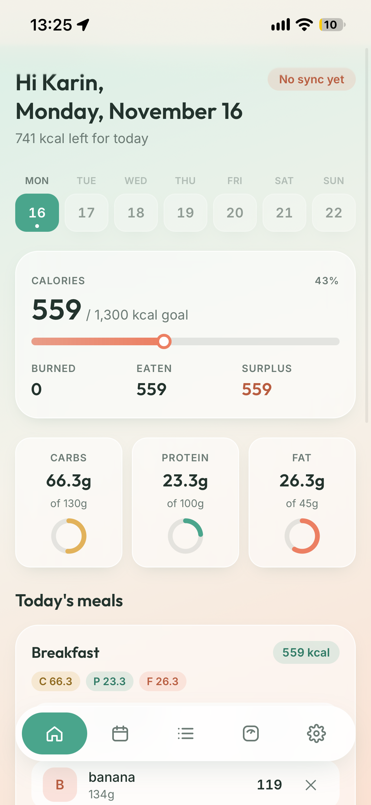

# Fitapp

A personal calorie and macro tracker that I built for myself and use every day on my iPhone.
At a glance it shows how many calories I've burned today (from my Apple Watch), how many I've
eaten, and the difference.

**Live:** [fitapp-sepia-pi.vercel.app/welcome](https://fitapp-sepia-pi.vercel.app/welcome). My own app is password protected, since it holds my personal data, but anyone can get their own free copy with the [setup guide](https://fitapp-sepia-pi.vercel.app/welcome/setup).



## Features

- **Today:** calories eaten, burned and left, plus carbs, protein and fat against daily goals
- **Food logging by meal** (breakfast, lunch, dinner) from a personal food library
- **Calendar and history:** past days, and month-by-month summaries
- **Weight log** with morning and evening weigh-ins
- **Settings** for profile and daily goals
- Light and dark mode
- Installable on the phone's home screen as a PWA, and it refreshes itself when reopened
- **A public landing page and setup guide** so other people can run their own copy

## Get your own

Every person gets their own copy instead of an account on mine, so nobody's health data
sits on someone else's server. The [setup guide](https://fitapp-sepia-pi.vercel.app/welcome/setup)
walks through it in about 15 minutes, with no coding:

1. A free Neon database
2. A sync key, made in the browser so it's never sent anywhere
3. A **Deploy to Vercel** button that copies the repo and asks for the settings
4. A shared Apple Shortcut that asks for your address and key when you add it
5. A daily automation that sends today and yesterday at 23:55

Database migrations run on every production deploy, so a fresh copy sets itself up.

## Tech stack

- **Next.js 16** (App Router, Server Actions) and **React 19**
- **TypeScript**
- **Drizzle ORM** with **Postgres** on Neon
- **Tailwind CSS v4**
- Deployed on **Vercel**

## Key decisions

- **A PWA plus an Apple Shortcut, not a native app.** Apple Health data only lives on the
  phone, so something on the phone has to send it out. A daily Apple Shortcut posts the Apple
  Watch data to an API route (`app/api/sync-health`). A React Native app could read it live,
  but keeping it installed needs the Apple Developer Program (about €100 a year) for an app
  with one user. The trade-off: the numbers are as fresh as the last sync, not live.
- **A personal food library.** Each food is saved once with its macros per 100 g, then logged
  by grams. The macros are copied into each log entry, so editing a food later doesn't change
  past days.
- **Local dates, not UTC timestamps.** Days are stored as the Slovenian date, so a late-night
  snack doesn't land on the previous day.
- **Simple, secure access.** It's a single-user app, so instead of a full auth system it uses
  one password and a long-lived cookie. The Apple Watch sync has its own token. Both are
  checked with constant-time comparison.

## Run it locally

You need Node.js 20 or newer and a Postgres database (for example a free one on [Neon](https://neon.tech)).

Create `.env.local` with:

```bash
DATABASE_URL=postgres://...      # your Postgres connection string
APP_PASSWORD=...                 # the password for the login page
HEALTH_SYNC_TOKEN=...            # the token the Apple Shortcut sends
TIMEZONE=Europe/Ljubljana        # optional: your time zone, decides what "today" is
```

Then:

```bash
npm install
npm run db:migrate   # create the database tables
npm run dev          # http://localhost:3000
```

On Vercel you don't need to run `db:migrate` yourself. Every production deploy runs
any new migrations before it builds, and skips the ones that already ran.
